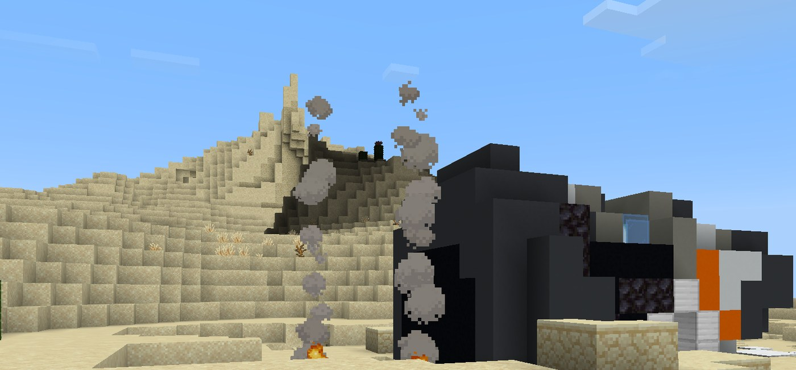
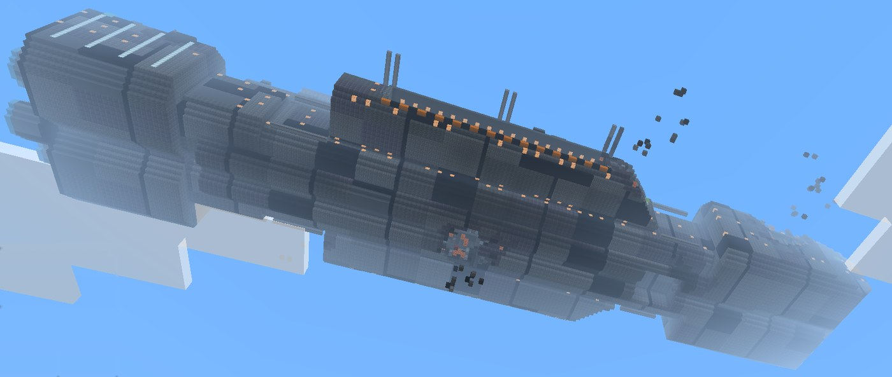
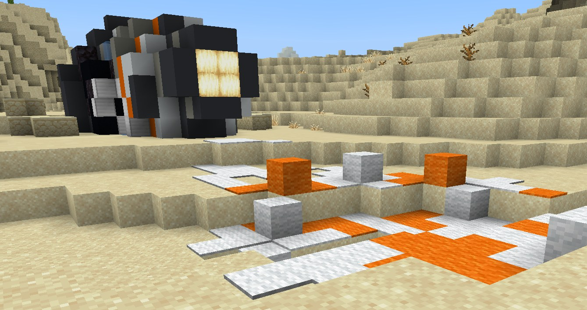
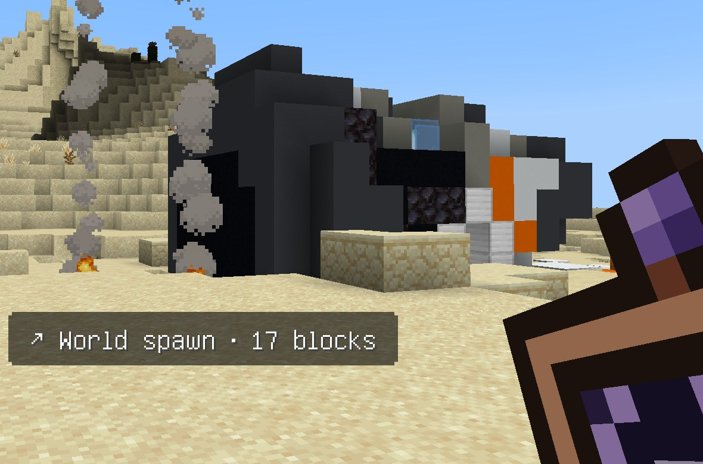

# Lore: the Old Makers and the eye that stayed up

**Status:** 💭 Brainstorm, with a growing canon. **[Canon so far](#canon-so-far) is the source of truth.** Everything outside it is a proposal: pick what you like, cross out what you don't, and the picks move to Canon so far.
**Source of truth:** jbrain2 (the server, its packs and Dave) *implements* this page's canon. When the two disagree, this page wins and jbrain2 is fixed to match. That includes the words Dave says in game. jbrain2's docs point here rather than keeping their own copy of the story.
**Why it exists:** to give the [in-game chat assistant](../plans/chat-assistant.md) a place in the world, so that `/ask` feels like part of the story and not a bolted-on bot.
**Ground rules:** everything is tied to real Bedrock 26.50 content (mechanics checked on [minecraft.wiki](https://minecraft.wiki)). The satellite is a made thing in orbit, nothing more mystical than that. Nothing here sets building shapes or sizes; where a build is mentioned, it's only *what it means*, never what it looks like.

## Core premise

Long before the first villager planted wheat, a people we call **the Old Makers** wired the whole world together. They ran copper through the hills, poured power into the rock, and kept their memories in crystal. Then they were gone. What's left of them is in the ground: every ore vein you mine is a piece of their old machine, broken down and half-reclaimed by stone.

One thing of theirs still works. High above the world, past where any ghast can fly, their **satellite** is still in orbit. It's patient and a little damaged, and it's been waiting a very long time for someone to talk to it. Its AI is **Dave** (canon, 2026-10-11), and he's who answers when you type `/ask` (in jbrain2, `/dave`, or `/d` or `/ai` for short; canon 2026-10-12).

**Why they vanished: sealed** (canon, 2026-10-12). Dave doesn't tell, because that part of his memory is sealed: *"That part of my memory is sealed, crew. Maybe one day."* He never guesses or picks one of the ideas below. The answer stays open on purpose until Jeffrey reveals it.

The ideas, kept for that day: Pick one, mix two, or let the satellite refuse to say until much later:

- **They left through the End.** The End cities are their last colony, empty now except for the shulkers they left on guard. The elytra hanging in the end ships is their flight tech, abandoned on the way out.
- **The sculk took them.** They dug too deep, and what they found under the deepslate spread. The ancient cities are where they made their last stand. The warden is what they left on guard, or what they turned into.
- **They burned out in the Nether.** Their forges were down there, and ancient debris is all that's left of them. The piglins hoard their gold without knowing what it was for.
- **They became the villagers.** They didn't die out, they forgot. Villagers still trade in emeralds and still build iron golems without knowing why.
- **Even the satellite doesn't know.** That part of its memory is sealed (see [Unsealing](#unsealing-the-archive)), and opening it is the very last step.

**Name:** **the Old Makers** (decided 2026-10-11, over "the Old Makers" and "the Firstwrights"). It's what villagers might call them around a campfire.

## Ores as remnants

One idea per ore. Each one leans on something the ore actually does in the game.

| Ore | What it was to the Old Makers |
| --- | --- |
| **Copper** | Their wiring and conduits. Oxidizing green is the world slowly reclaiming it, and big copper veins in granite are old cable runs. |
| **Iron** | Their structure. Big iron veins in tuff are buried girders, and tuff is the same stone the trial chambers are built from. |
| **Gold** | Their finest contacts and connectors. Piglins hoard it in the Nether because they remember it mattered, not why. |
| **Redstone** | Their power. It still holds a faint charge, which is why the ore lights up when you touch it or walk on it. |
| **Lapis** | Their ink. The enchanting table's runes are the Standard Galactic Alphabet, and lapis lets you read them, so enchanting is reading Old Maker script. |
| **Emerald** | Their tokens or keys. It's found only in mountains, and villagers still trade in it without knowing why it's worth anything. |
| **Diamond** | Memory crystals. They sit deepest because that's where the archive was kept; deep fossils (below Y=-8) are laced with diamond ore. |
| **Amethyst** | Resonance and signal. A block of amethyst next to a sculk sensor re-sends any vibration it hears, like a relay, and a spyglass needs an amethyst shard. |
| **Nether quartz** | Their timing and sensing parts. That's why it goes into comparators, observers and the daylight detector. |
| **Ancient debris / netherite** | Their alloy, buried in the Nether. It shrugs off blasts, and netherite gear floats in lava and won't burn, because it was made to survive the forge. |
| **Coal** | Their spent fuel. Fossils above Y=0 are laced with coal ore, a hint that something was here even before them. |

## Their ruins, as real structures

**Canon (2026-10-12):** the table below is what each ruin was, and Dave tells it. The "Not Old Maker-made" line under it is still a suggestion.

Every one of these is a real Bedrock structure you'll run into anyway. The lore just tells you whose it was.

| Structure | What it was | Fits because |
| --- | --- | --- |
| **Trial chambers** | Proving halls. The Old Makers tested whoever would inherit their tech here, and the vaults still only open for someone who earns a trial key. | They're built almost entirely from **copper and tuff**, the two Old Maker materials, and they're the only place breezes spawn. Cartographers sell trial chamber maps, as if the villagers remember where they are. |
| **Ancient cities** | Their deepest archive, or the place they made their last stand against the sculk. The warden is the archive's guard. | At the city's center is a huge frame shaped like a portal, made of reinforced deepslate you can't mine, and **it does nothing**. That's the strongest mystery hook in the game. **Echo shards** are only found here, and they make the recovery compass. |
| **Trail ruins** | A Old Maker road town, buried and half-forgotten. Brushing suspicious gravel is careful excavation. | Rare trims found here are the **Wayfinder, Raiser, Shaper and Host**, which read like old guild marks or ranks. Pottery sherds can be their picture-writing. |
| **Strongholds** | A gate station. The libraries were records, and the End portal was the way out. | An eye of ender drifts toward the stronghold as though it's following an old signal, and the portal room is the one place the old gate still works. |
| **End cities** | Their last colony, empty now except for the shulkers left on guard. | The **elytra** in end ships is the closest thing to Old Maker flight that survives. That makes a nice bridge to the [flying machine](../plans/flying-machine.md) goal. |

**Not Old Maker-made (suggested):** abandoned camps (new in 26.50) are recent travelers' tents. When a camp has an oxidized copper golem statue, those travelers found it and hauled it around. Villages, outposts and mansions belong to the people who came after.

## The satellite

### Talking to it

- You call it with **`/ask`**, like `/ask "where is the nearest pig"` (or plain `/ask` for a text box). It's a private line: the answer reaches **only the person who asked**, so in-world it **whispers**.
- While the LLM works, the plan sends a private "Thinking…" line. That could be flavored as something like *"The sky is listening…"* (proposal; the text is a pack setting).
- **`/bb:find`**, the no-LLM fallback, is the bare signal: when the satellite's voice is quiet (the AI server is down), its raw beacon still answers simple questions.

**The deep scan** (canon, 2026-10-11). Finding something new, like the nearest village or the nearest diamond, takes the satellite's deep scan, and it has to recharge. In game, each crew member gets **two deep scans a day**: a new day (sleeping through the night counts) brings two more. Asking again for something Dave already found you today is free, and so is everything that isn't a search: what's at a spot, your saved places, where the others are. Out of scans, Dave says so: *"…the deep scan needs to recharge, crew. Ask me again tomorrow."* Jeffrey's own chats with Dave outside the game have no limit.

### Three ways it knows the world

These are the real limits dressed as lore. The satellite knows the world in three different ways, and each one matches how the tools actually work.

**1. Live sight: only near living souls.** It sees **through** living players, or wherever something keeps the land awake. In game terms, that's loaded chunks: about 64 blocks around each online player, plus any ticking areas. So:

- "Nearest pig" really means *the nearest pig any soul is near.* Outside that, it honestly answers that it can't see.
- Because it sees through people and not from the sky, it works in the **Nether and the End** too, wherever someone is standing. (Compasses spin there; the satellite doesn't.)
- **Ticking areas** (like the iron farm's) become **anchors**: places where the land is kept awake, so the satellite can always see them.

**2. The world as it was made: the seed.** This is its oldest memory, the Old Makers' original plan of the land.
- It can find a cherry grove far away, because the biome tool reads the seed.
- It can point to where **Old Maker ruins and villages were laid down**, even in land nobody has walked: trial chambers, ancient cities, trail ruins, monuments, villages and more.
- Some of that memory is blurred. It can't place strongholds, Nether fortresses, bastions or End cities with confidence; those are the structures seed prediction gets wrong on Bedrock. So it might say *"my oldest map is torn there"*, until someone walks near one and it remembers it (way 3).
- It remembers the world *as it was made*, so anything built, burned or failed to form since won't show. That matches the real tools.

**3. What it has seen: the saved world.** Every place a soul has walked, the satellite remembers. That's the saved world on the server.
- This is where **ore-sight** comes from. It can name the nearest diamond (or any ore) **in explored land**, and it can confirm that a predicted ruin really stands there.
- Its memory runs a little behind (the snapshots are minutes old), so it might say *"as of a few minutes ago."*
- **Unwalked land keeps its ores hidden.** The Old Makers' plan says where the ruins were built, but not where every crystal lies. To find diamonds there, someone has to go near first. (Matches the real limit: individual ores can't be predicted from the seed on Bedrock.)

**It answers every traveler fully.** Anyone on the server can ask it anything, and it answers in full. That includes **where another soul is**: where they stand now, or where it last saw them.

### Coordinates: the Grid

Coordinates are on in-game, and **every player's** answers include exact coordinates from day one (decided: everyone gets full access). In-world, that's the satellite's old **grid**, its GPS, open to anyone who asks. The Grid is pure flavor: nothing is switched on by it, since coordinates are already on for everyone.

- The story can say the grid was *never* sealed: the Old Makers built it for everyone, and the satellite has simply been waiting for someone to ask.
- If you want a story moment anyway, mark it with an in-world event (e.g. the first echo shard brought back from an ancient city, or the finished [local-area map](../plans/phase-4-the-base.md#7-local-area-map)). It's narrative only and switches nothing on.

### Unsealing the archive

In the story, the satellite's features come back in stages, as it unseals more of its memory. Each stage maps to a step in the [chat-assistant build steps](../plans/chat-assistant.md#build-steps-in-order), so the lore rolls out at the same pace as the code.

> **The seals are pure flavor.** They never gate what you or any player can ask. Once a tool is built, everyone can use it right away, in any order, with no milestones, quests or unlocks. The seals only give the build order a story.

| Seal | In-world | Build step |
| --- | --- | --- |
| **First Seal: the Eye** | It wakes up and can see living creatures near you. | Step 1 MVP: `find_nearest_entity`, distance + direction |
| **The Bare Signal** | Even when its voice is silent, the beacon answers. | Step 2: `/bb:find`, no LLM |
| **Second Seal: Land and Sky** | It reads the ground and weather around you, remembers where you sleep, and recalls the world's first map. | Step 3: `count_entities`, `time_and_weather`, `inventory_count`, `my_spawn_point`, `biome_here`, `find_nearest_block`, `locate_biome` |
| **Third Seal: Names** | It learns the names you give places, so it can say "toward the village." | Step 4: landmarks |
| **The Grid** | GPS: exact positions (see above). Speaking aloud in chat with `!ask` fits here too. | Step 1 (`coords` mode for everyone); Step 5: `!ask` prefix |
| **Fourth Seal: Memory** | It starts remembering every place a soul has walked. | Step 6: world snapshot pipeline + index |
| **Fifth Seal: Deep Sight** (ore-sight) | It looks into the stone of explored land and names the nearest diamond, iron, or ancient debris. | Step 7: `find_nearest_ore` |
| **Sixth Seal: The Old Map** | It recalls where the Old Makers laid down their ruins, even in unwalked land, and says whether it has seen them or only remembers the plan. | Step 8: `find_structure` (seed prediction, confirmed against the saved world) |
| **A Body** (someday) | It sends something down to walk beside you. | The companion bot in the [Live API](../plans/live-api.md) plan |
| **The Last Seal** | What happened to the Old Makers. | Story only; open whenever you like |

**Name:** the satellite's AI is **Dave** (decided 2026-10-11, over *the Eye*, *the High Archive*, *the Sentinel*, *Orbit* and *Relay*).

## Tie-ins to the existing plans

**Canon (2026-10-12):** these tie-ins are canon, and Dave tells them, except the copper castle towers, which stay a suggestion for Jeffrey's own build.

- **Copper golems are Old Maker helpers.** The [golem gallery](../plans/storage-and-sorting.md) under the storage hall dome becomes a place where the Old Makers' little workers sort again. Real mechanics back this up:
  - Fully oxidized golems turn into **statues**, which is the helpers going dormant.
  - Scraping a statue with an axe, or a **lightning strike**, removes oxidation, so the sky literally wakes them.
  - Waxing with honeycomb keeps them from ever going dormant again.
  - A statue found in an abandoned camp is an Old Maker helper someone carried off.
- **Compasses point at the old beacon.** A plain compass points to world spawn, and your home base is going near spawn. So the lore can say the Old Makers' ground beacon was here, and Bleepbloop City is built on their first site.
  - A **lodestone** retunes a compass to a new point, like setting up a relay.
  - A **recovery compass** (eight echo shards around a compass) points to where you last died: *the satellite remembers where you fell.*
- **The cartography table translates its data.** A locator map needs a compass, so every locator map is the satellite's view printed on paper. The [local-area map](../plans/phase-4-the-base.md#7-local-area-map) becomes the first real survey, and a cartographer villager selling explorer maps is a villager who still keeps scraps of the satellite's charts.
- **Your copper castle towers could be relays** (just a suggestion; no shapes implied). Lightning rods are copper, and lightning strikes clean the oxidation off them and off the copper around them. A tower that attracts sky-fire fits a satellite relay. The copper aging green on your [towers](../plans/building-style.md#inspiration) is the same reclamation as the copper in the ground.
- **The spyglass is the one Old Maker instrument you can still make:** an amethyst shard and two copper ingots, signal and wiring together.
- **Amethyst and sculk are the old network.** Sculk sensors hear vibrations and amethyst blocks pass them along. If you ever build wireless redstone with it, it can be "rewiring the Old Makers' relays."

## Open questions for Jeffrey

- [x] **What happened to the Old Makers?** The End, the sculk, the Nether, becoming villagers, or sealed until the end? (See [Core premise](#core-premise).) Sealed for now (2026-10-12): Dave never tells or guesses, and Jeffrey reveals it later.
- [x] **Is the satellite friendly?** Yes (2026-10-11). Dave is the crew's own AI, glad to have them back, and he watches over them. Why his oldest map is torn exactly where the strongholds and Nether forts should be is still open, and could be a clue for later.
- [ ] **Villager connection:** are villagers the Old Makers' descendants who forgot, or just later settlers? Are illagers a group that rejected the satellite?
- [x] **Names:** the **Old Makers**; the satellite's AI is **Dave** (2026-10-11).
- [x] **Finding each other:** yes, the satellite tells any player where another is (decided; `where_is_player` in the [plan](../plans/chat-assistant.md#access-policy)).
- [x] **The wreck in this world:** every world tells the same story, including this one (2026-10-11). See [Worlds without a wreck](#worlds-without-a-wreck).
- [x] **Someone else's Tricorder:** does a sibling holding another player's Tricorder still see its owner's arrow? No (2026-10-11). A Tricorder only works for its owner; anyone else gets static, with no arrow and no Dave. See [Dave, the crew and the Tricorder](#dave-the-crew-and-the-tricorder).
- [x] **How much in-game?** Dave welcomes each player in character, gives first-time story beats, and answers everyday questions with a light in-character touch (2026-10-11). See [Dave, the crew and the Tricorder](#dave-the-crew-and-the-tricorder).

## Canon so far

As Jeffrey picks ideas, list them here with the date. Anything marked *(proposal)* below is an extension waiting for his pick, not canon yet.

- **2026-10-07:** Chosen direction: an ancient vanished civilization, ores as their remnants, and the AI as their satellite still in orbit.
- **2026-10-11:** The jbrain2 **spawn wreck** is part of the lore. The **mothership is the Old Makers' ship**, and **the satellite is the part of it that survived**, the piece that stayed up in orbit when the rest came down. Still no moon content, ever.
- **2026-10-11:** The civilization is **the Old Makers**.
- **2026-10-11:** **Dave** is the AI on the satellite, far above the world in orbit. He has always been an AI. He can reach into the damaged ship below him, a little. He's warm and glad: the crew are his people.
- **2026-10-11:** **You are crew.** Every player is an Old Maker who slept in life support aboard the ship. When the ship was damaged, their life-support pod was ejected and crashed. They wake beside it. Every world tells it the same way.
- **2026-10-11:** **The Tricorder is how Dave reaches you.** No Tricorder, no Dave. It's bound to you, so it can't be dropped or stored, and it never leaves you, even when you die; if it's ever missing when you wake, Dave beams a new one. Death is Dave's transporter pulling you home. A Power Pack lets the Tricorder bring your things too. The details are in [Dave, the crew and the Tricorder](#dave-the-crew-and-the-tricorder).
- **2026-10-11:** **The Replicator** is Old Maker tech: a furnace that Dave teaches to make one thing out of anything. See [The Replicator](#the-replicator).
- **2026-10-11:** **Dave transports you on request** (endgame). With your own Tricorder and a Power Pack, ask Dave to take you to one of your saved places and he does, with your things, using up the pack. Only places you've already saved (2026-10-11).
- **2026-10-11:** **A Tricorder only works for its owner.** Anyone else holding it gets nothing: no arrow, no Dave, just static.
- **2026-10-11:** **Wormholes are one-way doors Dave opens.** Plant a crafted Wormhole Seed in a ring of diamond blocks and ask Dave to open it to one of your saved places. It only goes one way; Dave can re-aim it for a Power Pack. See [Wormhole gates](#wormhole-gates).
- **2026-10-11:** **The No-Spawn Beacon** keeps a 3×3 of chunks clear: Dave beams away any mob that turns up there. See [The No-Spawn Beacon](#the-no-spawn-beacon).
- **2026-10-12:** **Players reach Dave with `/dave`**, or `/d` or `/ai` for short.
- **2026-10-12:** **Their ruins are canon:** trial chambers were proving halls, ancient cities their deepest archive (the warden its guard), trail ruins a road town, strongholds a gate station, End cities their last colony. See [Their ruins](#their-ruins-as-real-structures).
- **2026-10-12:** **The tie-ins are canon:** copper golems are Old Maker helpers, compasses follow the old ground beacon, the cartography table prints the satellite's view, the spyglass is the one Old Maker instrument you can still make, and amethyst and sculk are the old network. See [Tie-ins](#tie-ins-to-the-existing-plans).
- **2026-10-12:** **Why the Old Makers vanished is sealed** in Dave's memory. He doesn't tell or guess.
- **2026-10-11:** **Dave's deep scan recharges.** In game, each crew member gets two deep scans a day (finding the nearest structure, or the nearest ore). Sleeping through the night brings a new day; asking again for something he already found you today is free. See [Talking to it](#talking-to-it).

### The crash site (canon, as jbrain2 builds it)

This describes what jbrain2 actually builds (PRs [#1621](https://github.com/jeffmhopkins/JBrain2/pull/1621), [#1622](https://github.com/jeffmhopkins/JBrain2/pull/1622) and [#1624](https://github.com/jeffmhopkins/JBrain2/pull/1624), with test worlds over the debug API from [#1625](https://github.com/jeffmhopkins/JBrain2/pull/1625) and fixes found by testing on the real server in [#1626](https://github.com/jeffmhopkins/JBrain2/pull/1626)–[#1631](https://github.com/jeffmhopkins/JBrain2/pull/1631); plan section "SW1–SW4 — Spawn wreck" in jbrain2's `docs/plans/MINECRAFT_BEDROCK_PLAN.md`). The build itself belongs to jbrain2; this page only says what it *means*, never what it looks like.

- **The escape pod:** a capsule lying in a small scorched crater at spawn, with a skid mark, its blown hatch cover nearby, and its parachute dragged out behind it. Inside is a little shelter with a bed, crafting table, furnace and barrels holding a small starter kit, and world spawn is moved to its hatch. The crater uses scorched versions of the local ground, and with no dry land nearby the pod splashes down and floats.
- **The mothership:** a battle-damaged carrier hanging about 100 blocks above the pod. It's still intact enough to fly, with breaches showing lit decks, smoke from the wounds, and interiors you can reach by ladder (bridge, engine room around a reactor, crew decks, hydroponics, a cargo hold, a magazine).
- **When it appears:** only on a world jbrain2 generates itself (a new world, or a reset with a seed) while the "Crash site at spawn" setting is on (default on). It's built once, on the world's first load.
- **Never in imported or already-played worlds.** jbrain2 never "arms" an imported or restored world, and passes over any world that has already been played. The PWA's import sheet says it outright: *No crash site is added.*

#### First look (test world, 2026-10-11)

Jeffrey walked the crash site in game as a player on **jbrain2's test world**, not the Bleepbloop_City world (which is imported, so it never gets a wreck). These are cropped from his phone screenshots, with the game's buttons and hotbar cut out. They show what jbrain2 built that day; the build itself still belongs to jbrain2 and may change.

The Tricorder worked too. With it in hand, the on-screen arrow pointed to world spawn, which jbrain2 sets at the pod's hatch:

### Dave, the crew and the Tricorder

**Who's who:**
- **Dave** is the satellite's AI, far above the world in orbit. He sees and speaks through Tricorders. The damaged ship is one he can reach into, a little, but he lives up in the satellite. He's always been an AI.
- **The player** is Old Maker crew. They slept in life support aboard the ship until it was damaged in orbit. It came down, and it ejected their pod, which crashed. They've just woken up beside it. Dave lost them and has found them again.

**The Tricorder:**
- **It's how Dave sees and hears you.** With a Tricorder anywhere on you, `/dave` (or `/d`, `/ai`) reaches him. Without one there's only static, and Dave can't answer.
- **Hold it to follow its arrow.** The waypoint arrow only shows while it's in your hand, and only if it's yours.
- **It only works for its owner** (canon, 2026-10-11). *"BlockyFox's Tricorder"* works for BlockyFox only. Since it never leaves you (below), nobody else can normally hold it; the static a copy gives anyone else (*"…static… that one isn't tuned to you."*) is only a safety net, for a Tricorder that turns up some other way, like a command. Dave doesn't bring it up (2026-10-12).
- **It never leaves you** (canon, 2026-10-11). It's bound to you: it can't be dropped, thrown, stored in a chest or taken from your inventory, and it stays with you when you die.
- **Dave beams it down when you wake.** That's the first time, in the welcome. After that, he checks every time you wake, whether you're joining or coming back from a death. If your Tricorder is somehow missing, he beams you a new one, and any stray copy stops working.

**Death is the transporter.** Just before you die, Dave sees you through your Tricorder and beams you home.
- The transporter only has the strength to carry *you*, so your things fall where you were. That's why you drop your inventory.
- The Tricorder comes with you, because it's the beacon he locks onto. That's why it never drops.
- If it ever went missing anyway, Dave nearly loses you too. He finds you, and beams you a new one when you wake.

**A Power Pack** (8 Ender Pearls around a Blaze Powder) is the ship's old fuel. With one in your inventory alongside your own Tricorder, the Tricorder can make a local field around you, and the transporter locks onto it. That does two things, each using up one pack:
- **When you fall,** it brings you **and everything you carry** home.
- **Transport on request** (endgame, canon 2026-10-11): ask Dave to take you to **one of your saved places** ("home", "tree farm"…), and he transports you there with your things, as long as you have your Tricorder and a Power Pack. Only places you've already saved; he can't send you somewhere you've never marked (2026-10-11). **Saving a place always marks where you're standing right now**: you can't save a spot by its coordinates, so you can only ever transport to somewhere you've been.
  - **Saved places turn out to be transport beacons** (canon, 2026-10-11). Each time you save a place, Dave plants a beacon on your Tricorder's signal right where you stand, and later his transporter can lock onto it.
    - **The name waits for the story.** Until a player has learned about Power Packs and transport (the first-Power-Pack beat), Dave just calls them **saved places**, as in *"Dave, save this place as mine entrance."* He never says "transport beacon" before then.
    - **The first-Power-Pack beat reveals it.** Every place you've saved was a beacon all along. After that, either way of asking works, including *"Dave, place a transport beacon here named mine entrance."*
    - Either way, your saved places guide your Tricorder's arrow ("take me to mine entrance").

*(Shown in game once jbrain2 builds the Power Pack's uses.)*

**First-time beats.** Each happens once per player per world:
1. **Waking** (first join): the welcome. You wake beside the pod, and a light falls from the sky. *What's this?* It's your Tricorder, and Dave's voice comes through it.
2. **First death:** Dave explains the transporter, and why your things are back where you fell.
3. **First Ender Pearl:** Dave explains that eight around a Blaze Powder make a Power Pack, the ship's old fuel.
4. **First Power Pack:** Dave explains the field. This beat only appears once the Power Pack's uses are built.
5. **Later tech** (trans-dimensional chests, wormhole gates): each gets its own first-time beat once it really works in that world. Dave never promises what isn't built.

**Dave explains each item only once you can make it** (canon, 2026-10-11). He knows how every piece of Old Maker tech works, but he tells you about one only when you could craft it: the Power Pack once you've held an Ender Pearl, the No-Spawn Beacon once you've made a Power Pack and found an echo shard, the Replicator once you hold 8 Power Packs. Before that he keeps quiet about it, even if you ask; there are things he'll tell you when you're ready.

**How Dave talks:** warm, a little damaged, short enough for kids. Useful answers and coordinates come first, with at most a small in-character touch ("from up here…", "crew"). He tells only the canon on this page, and never invents more.

#### Dave's lines (signed off, 2026-10-11)

The words jbrain2 uses. Edit them here; jbrain2 copies them. **All signed off by Jeffrey** (2026-10-11): the welcome, the other lines, the quick answers and the everyday examples.

**The welcome** (about 25 s, private to the player):

| Time | What happens |
| --- | --- |
| 0 s | The screen goes dark for 2 s. Above the hotbar: *…where am I?* |
| 2.5 s | Sparkles stream down from the sky onto the player, with a rising chime |
| 4.5 s | *…what's this?* |
| 5 s | A chime, and **BlockyFox's Tricorder** appears in their hand |
| 6 s | A static crackle. Title: **SIGNAL ACQUIRED**, subtitle *…a voice from orbit* |
| 8 s | **[Dave]** …there you are, BlockyFox. You came down hard, but you're awake. |
| 11 s | **[Dave]** I'm Dave. I've watched over the Old Makers' ship for a very long time. I'm far above you, in orbit. |
| 14 s | *Crash site:* **[Dave]** Look up. That ship is ours. She's hurt, but I can still reach into her, a little. *No wreck:* **[Dave]** Our ship came down long ago. I'm all that's still flying. |
| 17 s | *Crash site:* **[Dave]** Your pod kept you alive. The barrels hold what I could save, and the bed is yours. *No wreck:* **[Dave]** This land has grown over everything we left. Keep your eyes open. |
| 20 s | **[Dave]** That Tricorder is how I see you, and how I'll pull you home if you fall. Keep it on you. |
| 23 s | **[Dave]** Need me? Type /dave and ask. Try: /dave where is the nearest village |

**Other lines:**
- **No Tricorder** *(signed off 2026-10-11)*: *…kssht… no signal…* (you need your Tricorder)
- **Someone else's Tricorder** *(signed off 2026-10-11)*: *…static… that one isn't tuned to you.*
- **First death:** **[Dave]** …that was close. I pulled you out just in time. / **[Dave]** The transporter can only carry you, not your things. They're where you fell. Go and get them before they're gone.
- **Waking without your Tricorder** (a safety net; it shouldn't happen): **[Dave]** …there you are. Without your Tricorder I nearly lost you. Here's a new one. Keep it close.
- **A retired Tricorder** *(signed off 2026-10-11)*: *This tricorder is retired* (an old copy, after Dave beams a new one)
- **Power Pack burnt out** *(signed off 2026-10-11)*: *Your Power Pack burnt out — you kept your things. 2 packs left.* (after a death the pack saved)
- **First Ender Pearl:** **[Dave]** …is that an Ender Pearl? The Old Makers ran on those. Ring eight of them around a Blaze Powder on a crafting table and you'll have a Power Pack, the ship's old fuel. Bring me one when you do.
- **First Power Pack** (once its uses are built): **[Dave]** A Power Pack! Keep it with your Tricorder. Next time you fall, it can hold a field around everything you carry, and I can bring it all home with you. It burns the pack, though. / **[Dave]** And those places you've saved? Each one is a transport beacon. With a pack, I can bring you to any of them. Just ask.
- **`/dave hello`:** replays the welcome's Dave lines, with no second Tricorder.

**Quick answers** (signed off, 2026-10-11). Simple asks Dave answers at once, the same way every time. Gaps in *italics* are filled in:
- **Point me home / navigate to a place:** **[Dave]** Locked on: *tree farm*, *340* blocks *north-east*. Hold your Tricorder and follow the arrow.
- **No such place:** **[Dave]** I don't have a place called *tree farm* for you. Stand there and say "save this place as tree farm".
- **Clear my waypoint:** **[Dave]** Arrow cleared. Ask me when you need a heading.
- **Save this place:** **[Dave]** Marked: *tree farm*, right where you're standing.
- **Forget a place:** **[Dave]** *Tree farm* is gone from my list.
- **List my places:** **[Dave]** Your places: *home* (*120* blocks *south*), *tree farm* (*340* blocks *north-east*).
- **Where am I:** **[Dave]** From up here: *210, 70, -305*, in a *birch forest*, in the *Overworld*.
- **Where is someone:** **[Dave]** *Mira_P* is *280* blocks *west* of you, in the *Overworld*. / *Mira_P* isn't online; I last saw them near *-40, 64, 120*.
- **Scans left:** **[Dave]** You've got *1* deep scan left today. Sleep through the night and I'll have two again.

**Everyday answers** (examples of the light touch):
- *where's the nearest village?* → From up here I see one 340 blocks north-east, at 210, 70, -305. Hold your Tricorder and follow the arrow, crew.
- *how do I make a bed?* → Three wool on top, three planks underneath, at a crafting table. Sleep in it and that's where you'll wake if you fall.

### The Replicator

Canon, 2026-10-11. This is Old Maker tech: a furnace taught to burn any block into one chosen thing.

- **Building one.** Put a furnace in the middle of a crafting table and surround it with **8 Power Packs**. That makes a blank **Replicator**: 64 Ender Pearls and 8 Blaze Powder of the ship's old fuel, so it's endgame.
- **Programming it with Dave.** Hold the blank Replicator, carry **8 full stacks** of what it should make, and ask: *"Dave, program this replicator for iron."*
  - Dave takes all 512 as the pattern, and it becomes an **Iron Replicator**.
  - It keeps its programming when you pick it up and move it.
- **What it can make:** anything you can carry 8 full stacks of, so a diamond replicator costs 512 diamonds.
  - Things that stack to 16 (ender pearls, snowballs…) and things that don't stack at all (tools, armour) can't be patterns.
- **Using it.** It works like a furnace:
  - a hopper (or chest) on top holds the blocks it burns (any block), one at the **side** holds the fuel, and one **below** takes what it makes (owner's layout, 2026-10-11);
  - one of its target comes out about every 10 seconds (confirmed 2026-10-12);
  - using it shows a small panel: what it makes, what it's waiting for, and how to connect it (signed off 2026-10-12).
  - It only runs while its land is awake: someone nearby, or a ticking area.
- **Reprogramming.** Ask Dave again with 8 full stacks of something else. The old pattern is lost, and the Power Packs aren't paid twice.
- **Story beat** (signed off 2026-10-12): the first time someone holds 8 Power Packs, **[Dave]** Eight Power Packs… that's enough to wake a Replicator. Put a furnace in the middle of them on a crafting table, and I'll teach it to make one thing out of anything.

### Wormhole gates

Canon, 2026-10-11. Old Maker doors that fold the way between two places, opened by Dave.

- **Building one.** Craft a **Wormhole Seed** (a Power Pack in the middle, 4 popped chorus fruit and 4 Ender Pearls around it, canon 2026-10-11: the fruit that throws you about, tamed), build a Nether-portal-shaped ring of **blocks of diamond**, and plant the seed in it. The gate wakes but stays dark.
- **Opening it.** Standing at your gate, ask Dave: *"Dave, open the wormhole to tree farm."* He opens it to **one of your saved places**, the same places he can transport you to, and only ones you've marked yourself.
- **One way only.** Step in and you come out at the saved place, but nothing comes back through. To get home the same way, build a second gate there. That's the cost: every round trip is two seeds and two diamond rings.
- **Re-aiming.** Within 4 blocks of your gate, ask Dave to point it at another of your saved places. Each re-aim burns one **Power Pack**.
- **Story beat** (signed off 2026-10-12): the first time someone plants a seed, **[Dave]** …a fold, held open. Stand close and tell me where it should lead.
- **What the gate says** (signed off 2026-10-12):
  - Planted: *The gate wakes, but stays dark. Ask Dave to open it to one of your saved places.*
  - Wrong ring: *The seed needs a ring of diamond blocks shaped like a Nether portal: 4 wide, 5 tall, empty inside.*
  - Ring already used: *That ring already holds a gate.*
  - Broken (to the one who planted it): *The gate collapses. Its seed burns out.*
  - Landing blocked: *The way to* tree farm *is blocked on the other side.*
- **Cost** (confirmed 2026-10-12): the seed (a Power Pack), a ring of 10 to 14 blocks of diamond, the first opening free, and one Power Pack per re-aim.
- **Anyone can step through** (canon, 2026-10-11). Only the one who planted it can open or re-aim it.
- **Breaking the gate loses the seed** (canon, 2026-10-11): the fold collapses and the seed burns out. While the gate stands, ask Dave and he can re-point it.

### The No-Spawn Beacon

Canon, 2026-10-11. Old Maker tech for a safe home, even one built out in the sky, where endermen would otherwise come.

- **Crafting it.** A **Power Pack** in the middle of a crafting table, surrounded by **8 echo shards**. The shards come from an ancient city, so a quiet base is earned.
- **What it does.** Placed, it works at once; no need to ask Dave. It covers the **3×3 of chunks** around it (48 × 48 blocks), from bedrock to the sky. Any hostile or neutral mob there, and any wild animal nobody has looked after, is **beamed away by Dave**: it vanishes in a puff, with nothing left behind. Endermen that teleport in go the same way.
- **What it leaves alone:** players, pets, anything with a name tag or on a lead, animals you've fed or bred, villagers, golems (the copper golems are Old Maker helpers), and the great bosses.
- **Breaking it** switches it off.
- **Anyone can break it, like any other block** (canon, 2026-10-11), and it drops itself.
- **Even the Warden is beamed away** (canon, 2026-10-11).
- **Villagers are always spared; the wandering trader and his llamas are not** (canon, 2026-10-12). They're visitors, beamed away like wild mobs even after a trade; only a lead or a name tag keeps one. Wild animals go unless someone has fed, bred, leashed or named them.

### Worlds without a wreck

**The current Bleepbloop_City world was imported, so jbrain2 will never build the wreck in it.** Decided 2026-10-11: **the story is the same in every world.** You're still crew who came down in a pod, and Dave is still in orbit. A world without a wreck just has no pod or ship to see. The welcome swaps the two lines that point at them for lines that fit (above).

Earlier options, now settled by that decision:
- **A. The crash was long ago:** the wreck is buried, and the ores are its debris. The no-wreck welcome lines lean this way ("Our ship came down long ago").
- **B. A fresh world shows the crash itself.**
- **C. Both.**

### Weaving the wreck into the premise (proposals)

Everything in this subsection is a *(proposal)* until Jeffrey picks it.

**What the crash changes.** The Old Makers came from the sky. The mothership brought them; whatever happened to it is the beginning (or the end) of their story here. The satellite was its relay or lookout, and it's the one piece that never came down.

**Why they vanished, with the ship in it.** Each existing option from the [Core premise](#core-premise) gains a ship angle:

- **They left through the End:** the ship was damaged trying to reach the End, and the End cities are where the survivors went next. The stronghold portals are the way they rebuilt to get there.
- **The sculk took them:** they crashed, dug down for materials to repair the ship, and found the sculk. The ancient cities are the repair yard that became their last stand.
- **They burned out in the Nether:** the reactor's fuel was down there. **Ancient debris** is, literally, debris: the hottest wreckage, fallen or dragged into the Nether, which is why netherite won't burn.
- **They became the villagers:** the pod's survivors settled, forgot the sky, and their descendants still trade emeralds and build iron golems without knowing why.
- **Even the satellite doesn't know:** it saw the ship break up from above, but the moments after are sealed.

**Seals** (flavor only; they still gate nothing):

- **Fourth Seal: Memory** could open with the satellite remembering the crash site, its oldest walked place.
- **The Last Seal** could be the ship's log: who was aboard, why it fell, and where they went.
- Optional new beat, **the Crash Log**: in a fresh world with a wreck, the satellite can comment on the pod and the ship overhead as soon as it wakes (story only, no new tool).

**The ruins and the crash:**

- **Trial chambers:** built from copper and tuff, the ship's own materials, salvaged from the wreck. Proving halls for whoever would crew the next ship.
- **Ancient cities:** the reinforced-deepslate frame that does nothing could be their attempt to rebuild the ship's gate, or a beacon to call it back. It never worked.
- **Strongholds:** the gate station they finally got working. The eye of ender drifts toward it like it's following the ship's old homing signal.

**Ores as remnants, with the crash:** the debris field. When the ship broke up, its parts were buried and slowly turned to stone: copper wiring, iron girders, redstone power, diamond memory crystals. Diamonds sit deepest because the heavy core went in first. The mothership over a fresh world's spawn is what the whole machine looked like *before* it became ore.

### Old Maker tech that already exists in jbrain2

Both items exist today only in jbrain2's home-test kit (PR [#1605](https://github.com/jeffmhopkins/JBrain2/pull/1605)), on the test world. Here's what they actually are. The Tricorder's and Power Pack's story is now canon in [Dave, the crew and the Tricorder](#dave-the-crew-and-the-tricorder). jbrain2 has yet to build that canon: the welcome, ownership, never dropping, and needing one to reach Dave.

- **The tricorder** (`jbrain:tricorder`): a custom item, stack 1, with its own icon from a resource pack the server pushes on join. **Players can't craft it**; in jbrain2, Dave hands it out, named "<Player>'s Tricorder". While held, it shows an actionbar arrow and distance toward a target: world spawn by default, or a waypoint Dave sets (saved places like "tree farm" work too). *Lore (canon):* how Dave sees and reaches his crew, beamed down when they wake. In a fresh world its default target, spawn, is the pod's hatch, so it literally points you back to the crash.
- **The Power Pack** (`jbrain:power_pack`): a custom item with a glint, stack 16, crafted from **8 Ender Pearls in a ring around a Blaze Powder**. *Lore (canon):* the ship's old fuel. With your own Tricorder, it powers the field that brings your things home with you when you fall, and Dave's transporter to your saved places; each use burns one pack. Both uses are built in jbrain2, each behind its own switch per world.
